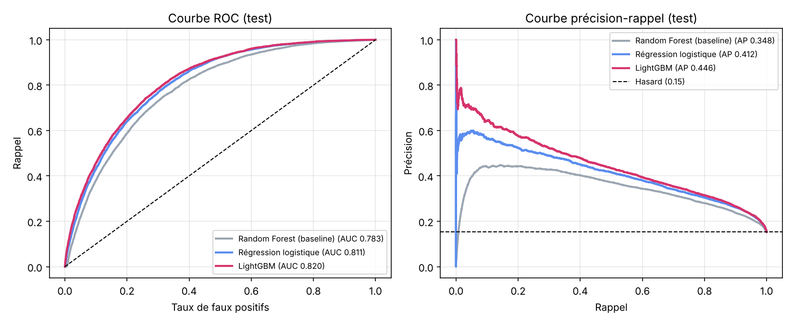
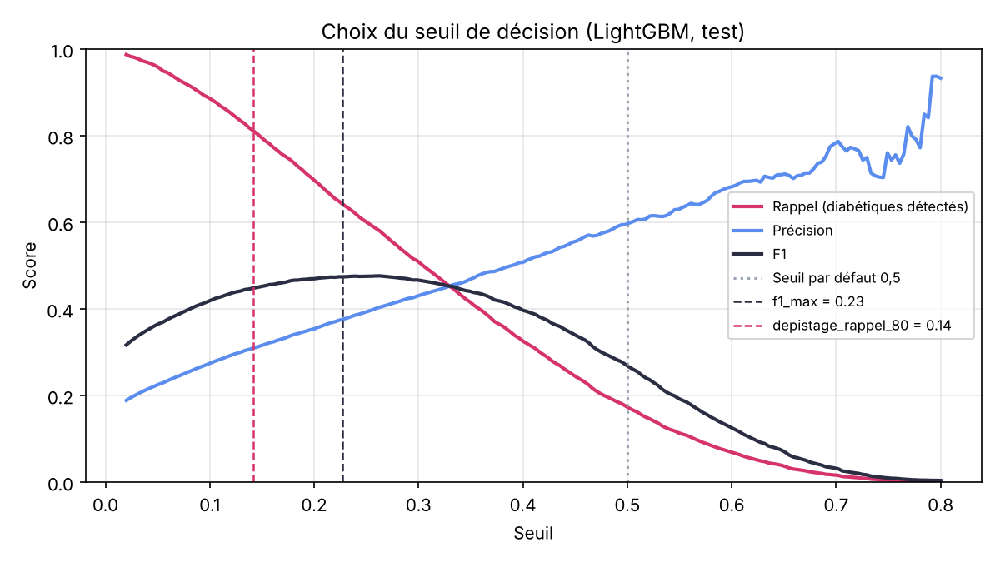
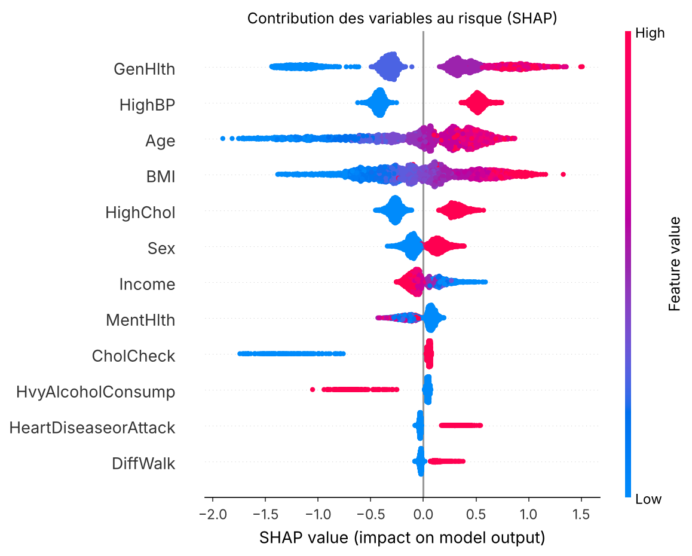

# 🩺 Prédiction du risque de diabète : CDC BRFSS 2015

Modèle de **dépistage du diabète** à partir de 21 indicateurs de santé déclarés (tension, IMC, âge,
activité physique, revenu…) issus de l'enquête américaine **CDC BRFSS 2015** (229 474 répondants
après dédoublonnage).

   

## Points clés

- **Données déséquilibrées (15 % de diabétiques).** L'accuracy est trompeuse : on évalue avec
  ROC-AUC, PR-AUC, rappel et F1 de la classe diabétique.
- **Le vrai levier était le seuil de décision, pas seulement le modèle.** Au seuil par défaut de 0,5,
  le meilleur modèle ne détecte que 17 % des diabétiques. Un seuil choisi par validation croisée
  permet d'en détecter **81 %** en mode dépistage.
- **Comparaison de 3 modèles** (Random Forest, régression logistique, LightGBM) en validation
  croisée stratifiée 5 plis.
- **Seuils choisis sans fuite** : sur les prédictions *out-of-fold* du train, jamais sur le test.
- **Explicabilité SHAP** : santé générale perçue, hypertension, âge, IMC et cholestérol sont les
  principaux facteurs de risque.

## Résultats (jeu de test : 45 895 personnes)

| Modèle | ROC-AUC | PR-AUC | Rappel @0,5 | F1 @0,5 | F1 @seuil optimisé |
|---|---|---|---|---|---|
| Random Forest (baseline) | 0,783 | 0,348 | 0,447 | 0,416 | 0,439 |
| Régression logistique | 0,811 | 0,412 | 0,760 | 0,449 | 0,462 |
| **LightGBM** | **0,820** | **0,446** | 0,173 | 0,269 | **0,475** |

PR-AUC d'un modèle aléatoire : 0,153 (prévalence).

**Points de fonctionnement de LightGBM :**

| Seuil | Rappel (diabétiques détectés) | Précision | Spécificité | F1 |
|---|---|---|---|---|
| 0,50 (défaut) | 17,3 % | 59,5 % | 97,9 % | 0,269 |
| 0,23 (F1 max) | 64,2 % | 37,6 % | 80,8 % | **0,475** |
| **0,14 (dépistage)** | **81,1 %** | 31,0 % | 67,4 % | 0,449 |

En mode dépistage, environ une alerte sur trois est un vrai diabétique : adapté pour orienter vers
un test sanguin de confirmation, pas pour poser un diagnostic.

<p align="center">
  <br>
  
  
</p>

## Structure

```
├── data/                         # CSV BRFSS 2015 + train.csv / test.csv
├── notebooks/
│   ├── 01_nettoyage_et_split.ipynb   # contrôle qualité, doublons, split stratifié 80/20
│   └── 02_modelisation.ipynb         # comparaison, seuils, SHAP, limites
├── src/
│   ├── pipeline.py               # fonctions de modélisation, métriques et figures
│   └── train.py                  # entraînement complet en une commande
├── reports/
│   ├── metrics.json              # métriques finales
│   ├── model_comparison.csv
│   └── figures/
├── models/lightgbm.joblib        # modèle + seuils
└── requirements.txt
```

## Reproduire

```bash
pip install -r requirements.txt
python src/train.py        # ~3 min sur CPU : modèle, métriques et figures
```

## Données

| Fichier | Lignes | Cible |
|---|---|---|
| diabetes_binary_health_indicators_BRFSS2015.csv | 253 680 | 0 / 1 |
| diabetes_binary_5050split_health_indicators_BRFSS2015.csv | 70 692 | 0 / 1 équilibré |
| diabetes_012_health_indicators_BRFSS2015.csv | 253 680 | 0 / 1 / 2 (prédiabète) |

Source : [CDC BRFSS 2015 via Kaggle](https://www.kaggle.com/datasets/alexteboul/diabetes-health-indicators-dataset), licence CC0 1.0.
Nettoyage : 24 206 doublons exacts retirés **avant** le split, pour qu'une même ligne ne soit pas à
la fois dans le train et le test.

## Limites

- Données **déclaratives** (enquête téléphonique) : biais de mémoire et de désirabilité sociale.
- Variables surtout binaires ou ordinales : ROC-AUC ~0,82, proche de ce que rapporte la littérature
  sur ce jeu de données.
- Les effets observés (ex. revenu) sont des **corrélations**, pas des causes.
- Projet d'analyse et d'apprentissage, **pas un outil de diagnostic médical**.

## Auteure

**Hayet Belloumi** · M2 Data Science, ISIMM ·
[GitHub](https://github.com/Hayet-belloumi) · [LinkedIn](https://www.linkedin.com/in/hayet-balloumi-457070230/) · [Portfolio](https://hayet-belloumi.vercel.app)
